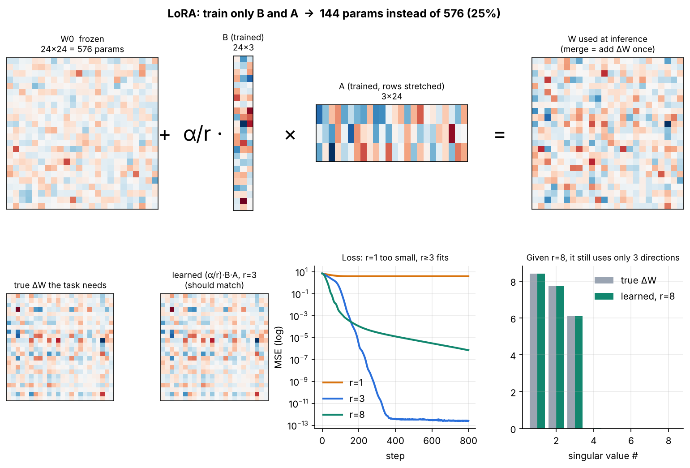
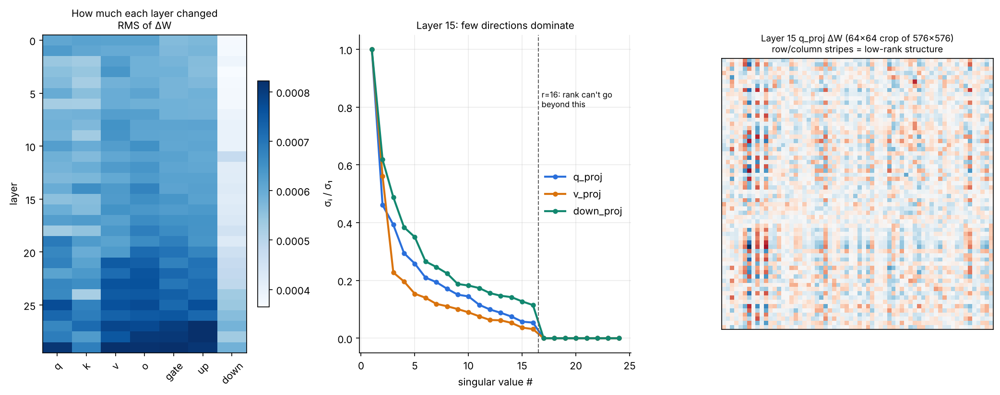

# LoRA & PEFT — small, runnable examples

Four scripts that go from the maths of LoRA to fine-tuning a real LLM, then opening up the trained adapter to see what it learned. Everything runs on a CPU.

| File | What it teaches | CPU time (approx.) |
|---|---|---|
| `01_lora_from_scratch.py` | LoRA in ~40 lines of plain PyTorch; effect of rank `r`; merging | ~1 min |
| `02_peft_sentiment_classification.py` | PEFT + HF `Trainer` for classification (DistilBERT, IMDB); saving/reloading a ~3 MB adapter | 5–20 min |
| `03_peft_llm_scorecard_to_json.py` | LoRA on SmolLM2-135M for structured extraction (cricket result → JSON); loss masking; custom loop; `merge_and_unload`; QLoRA notes | ~15 min |
| `04_visualize_lora.py` | Heatmaps and singular values of `W0 + (α/r)·B·A`, for a toy layer and for the adapter from script 03 | seconds |

## Results (2-core CPU run)

- **01:** with a task that needs a rank-4 change, r=1 underfits (loss 3.69). r=4 fits it (loss ≈ 2e-6) while training 1.5% of the layer.
- **02** (500 training reviews, 1 epoch): 77.5% test accuracy, training 1.1% of the parameters; the adapter is 3 MB.
- **03:** exact-match JSON accuracy went from 0% → 100% on 20 held-out examples. Those examples are synthetic and use the same templates as training, so this shows the model learned the format, not that it generalises to messy real scorecards.




## Run locally (Windows / PowerShell)

```powershell
python -m venv .venv
.\.venv\Scripts\Activate.ps1
pip install torch --index-url https://download.pytorch.org/whl/cpu   # or the CUDA build if you have an NVIDIA GPU
pip install -r requirements.txt

python 01_lora_from_scratch.py
python 02_peft_sentiment_classification.py --train_size 500
python 03_peft_llm_scorecard_to_json.py
python 04_visualize_lora.py        # fig 2 needs the outputs/ folder from script 03
```

On macOS or Linux, activate with `source .venv/bin/activate`. Models and datasets download from the Hugging Face Hub on first run.

Scripts 02 and 03 can be very slow on some Windows CPU setups. If script 03 doesn't print a progress line within a couple of minutes, run it on Google Colab (free T4 GPU), where it takes about a minute.

## Knobs that matter

- `r`: how much the update can change. Start at 8–16. Bigger is not automatically better (see script 01). The singular-value plot in script 04 shows how many directions an adapter actually uses.
- `lora_alpha`: scales the update. `alpha = 2*r` is a common default; tune the learning rate before changing this.
- `target_modules`: which layers get adapters. Names differ per architecture: BERT `query/value`, DistilBERT `q_lin/v_lin`, Llama/Qwen/Mistral `q_proj, k_proj, v_proj, o_proj, gate_proj, up_proj, down_proj`. Print `model` to see the names, or use `target_modules="all-linear"`.
- `modules_to_save`: layers that are new or must be fully retrained, e.g. a fresh classification head.
- Learning rate: LoRA usually wants ~1e-4 to 5e-4, higher than full fine-tuning (~2e-5).

## References

- Hu et al., 2021 — *LoRA: Low-Rank Adaptation of Large Language Models*
- Dettmers et al., 2023 — *QLoRA: Efficient Finetuning of Quantized LLMs*
- Hugging Face PEFT docs
